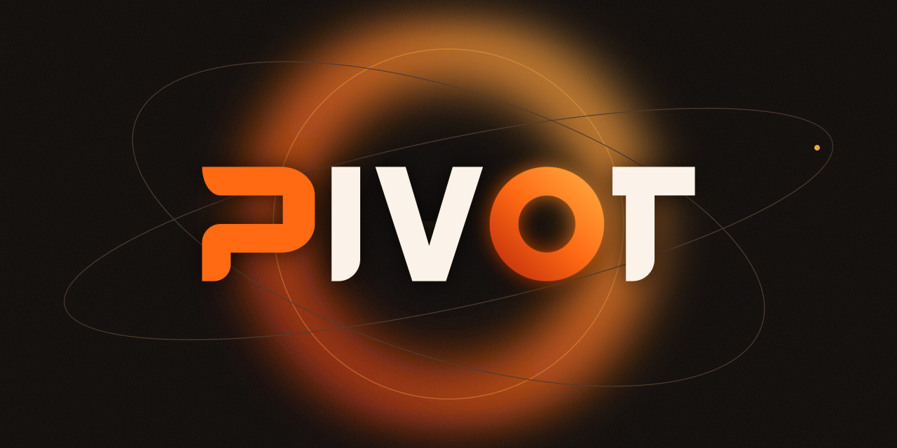

<p align="center">
  
</p>

# PIVOT

PIVOT is your own library of UI references, and the place where Claude Code designs from it.

- **Collect** screenshots of real websites as you browse: full pages, sections, interaction states and recorded motion, tagged by page type, domain, style and pattern.
- **Design with Claude Code.** In any project, ask Claude to design or rework a screen. It searches **your** references, shows you a shortlist to pick from, writes a short brief, and puts 2–3 mockups in PIVOT. Nothing is built until you approve one, with a passphrase only you know. Then it builds the approved version with your project's own components and checks it.
- **Local and private.** PIVOT runs on your machine (`127.0.0.1` only). Your library stays in a folder on your computer unless you point it at your own Postgres or R2 bucket.

> **Status:** early, built and used by one person. Expect rough edges. The npm package isn't published yet, so for now [run it from source](#from-source).

## Quick start

You need [Node.js 22+](https://nodejs.org) and [Claude Code](https://code.claude.com). Chrome is optional, for the extension.

1. **Run PIVOT** (it opens at <http://127.0.0.1:4321>; the first start downloads Chromium for screenshots, about 150 MB):

   ```bash
   npx pivot-studio
   ```

2. **Set your owner passphrase.** Approving a design asks for it, so an agent can never approve on your behalf. Run this in your own terminal:

   ```bash
   npx pivot-studio passphrase
   ```

3. **Connect Claude Code** with the plugin (Claude Code 2.1.292 or newer), then start a new Claude Code session:

   ```bash
   claude plugin install pivot --marketplace PTan2505/pivot
   ```

4. **Check everything:**

   ```bash
   npx pivot-studio doctor
   ```

5. **Save a few references:** paste a URL into PIVOT (⌘V anywhere), or use the [Chrome extension](#chrome-extension). Then, in a project, ask Claude Code: _"Design the pricing page with /pivot:design"_.

### From source

```bash
git clone https://github.com/PTan2505/pivot.git && cd pivot
corepack enable   # provides the pnpm version the repo pins
npm start
```

`npm start` installs dependencies and Chromium when they're missing, rebuilds when the code changed, serves on <http://127.0.0.1:4321> and opens the browser. Set the passphrase with `pnpm owner:passphrase`. For the plugin, add the marketplace from your checkout so edits apply at the next session:

```bash
claude plugin marketplace add "$PWD"
```

```bash
claude plugin install pivot@pivot
```

## Your data and privacy

- **Where it lives:** `~/.pivot` (or `PIVOT_DATA_DIR`): the local database (PGlite), screenshots and files, the API token, and the hash of your owner passphrase. Back it up like any folder, or use **Settings › Backup & restore**.
- **What leaves your machine:**
  - the pages you save: PIVOT fetches them, their metadata and favicon, and screenshots them in a local Chromium;
  - catalog searches: when the library falls short, Claude can search three free component catalogs (Magic UI, React Bits, shadcn/ui) with generic words, never your brief or project names;
  - your own Postgres and R2, only if you configure them.

  The npm package turns off Next.js telemetry. A checkout follows Next.js's default; turn it off with `npx next telemetry disable`.

- **Who can write:** PIVOT answers only on `127.0.0.1`. Writes need PIVOT's own pages or its API token (`~/.pivot/api-token`), which the extension and the Claude Code tools use. Approving a design needs your passphrase on top. See [SECURITY.md](SECURITY.md).

## Configuration

Put settings in `~/.pivot/.env` for the npm package, or in `.env` at the repo root for a checkout. Everything is optional.

| Variable                                                                 | Default            |                                                                                                                                                       |
| ------------------------------------------------------------------------ | ------------------ | ----------------------------------------------------------------------------------------------------------------------------------------------------- |
| `DATABASE_URL`                                                           | _unset_            | Unset → embedded Postgres (PGlite) in `~/.pivot/db`, works offline. Set → Neon/any Postgres.                                                          |
| `PIVOT_DATA_DIR`                                                         | `~/.pivot`         | Database (local mode), files (when R2 is not set), cache, default export folder.                                                                      |
| `R2_ACCOUNT_ID`, `R2_ACCESS_KEY_ID`, `R2_SECRET_ACCESS_KEY`, `R2_BUCKET` | _unset_            | All four set → screenshots and uploads go to a private Cloudflare R2 bucket instead of this computer. `R2_ENDPOINT` only for EU-jurisdiction buckets. |
| `CLAUDE_SKILLS_DIR`                                                      | `~/.claude/skills` | Global skills that the Skills view syncs with (only shown with other resource types on).                                                              |
| `PORT`                                                                   | `4321`             |                                                                                                                                                       |

Files go to Cloudflare R2 when the R2 keys are set, otherwise to the data folder. The app serves them itself, so the bucket stays private. Each file remembers where it lives, so switching is safe; **Settings › Files** has **Test storage** and **Move local files to R2**.

## Everyday use

- **⌘K:** search everything, jump anywhere, create.
- **⌘V anywhere:** paste one or many URLs to add them; paste an image to save it. Drag files onto the window to upload.
- **Collections, sources and facets** keep the library findable: page type, domain, visual style and UI pattern.
- **Design sessions** (the **Design sessions** button, `/design`): every brief, mockup round, approval, decision and QA report Claude records, per project.
- **Trash** keeps deleted items for 30 days.
- **Other resource types:** PIVOT started as a wider resource bag (prompts, snippets, rules, checklists, Claude Code skills, MCP configs, export and share). Those are hidden by default; turn them on in **Settings › Other resource types**.

## Chrome extension

```bash
npx pivot-studio extension
```

This puts the extension in `~/.pivot/extension` (from source: `pnpm ext:build`, then use `apps/extension/dist`). In Chrome, open `chrome://extensions`, turn on **Developer mode**, click **Load unpacked** and pick that folder. Then open the extension's options and paste the server URL and API token from **PIVOT › Settings › Browser extension**.

- **⌥⇧S** or the toolbar button: a popup with a screenshot of what you see (works on logged-in pages), the title and description read from the page, type, facets, notes and collection.
- **⌥⇧D:** quick-save the current tab without the popup.
- **Right-click** a page, link or image → _Save … to PIVOT_.

The token is what lets the extension write to PIVOT; regenerate it in Settings if it leaks.

## Design with Claude Code

The `pivot` Claude Code plugin (in [`plugin/`](plugin)) contains:

- **The `pivot` MCP server:** the tools Claude uses to search and look at your library, and to keep a design session's brief and decisions in PIVOT.
- **Two skills:**
  - `/pivot:design` for new screens and components;
  - `/pivot:redesign` for UI that already exists.
- **The `pivot:specialist` agent:** read-only; the skills use it to run specialist skills.
- **A session-start check** that tells you when PIVOT isn't running.

If PIVOT runs on another port, set the plugin's **PIVOT address** option (`/plugin`). Claude Code shows the plugin's tools as `mcp__plugin_pivot_pivot__*`.

### Specialist skills (optional)

The design skills get a second opinion from other Claude Code skills when you have them installed: `ui-ux-pro-max` (UX structure), `design-taste-frontend` (public web pages), `impeccable` (QA audit; `claude plugin marketplace add pbakaus/impeccable`) and `animate` (motion). Without them, PIVOT still works and reports each one as unavailable.

### Tools (the plugin's `pivot` MCP server)

| Tool                     | Kind  | What Claude uses it for                                                                                     |
| ------------------------ | ----- | ----------------------------------------------------------------------------------------------------------- |
| `list_facets`            | read  | Learn the library's vocabulary once per task: page types, domains, styles, patterns, collections            |
| `search_references`      | read  | Find references by words and facets, inside a collection or from a source                                   |
| `get_reference`          | read  | One reference's link, description, your notes, facets, screenshots and motion evidence (observed / unknown) |
| `get_reference_images`   | read  | Look at it: the cover, the full page in ~2,000-token slices, motion keyframes or interaction states         |
| `search_external`        | read  | Free public component catalogs (Magic UI, React Bits, shadcn/ui), only when the library falls short         |
| `get_design_session`     | read  | Read a session to continue earlier work, or the approval you made in PIVOT                                  |
| `propose_references`     | write | Put the 6–10 recommended references on the session's page, numbered, for you to pick from                   |
| `select_references`      | write | Record which of them you picked, in your own words                                                          |
| `save_design_brief`      | write | Store the brief at a milestone: `initial` (opens a design session), `approved`, `major_change`              |
| `save_design_mockups`    | write | Put a round of mockups on the session's page in PIVOT, where you compare them and approve one               |
| `record_chat_approval`   | write | Record the user's approval given in the chat, with their words quoted and the version's digest              |
| `record_design_decision` | write | Record a `change` after approval or a QA `deviation` (approvals are yours, in PIVOT)                        |
| `record_design_qa`       | write | Record the QA report (slop check, specialists, what stayed unverified) before the session is marked done    |
| `set_design_status`      | write | Mark an approved session `building` when Claude starts coding, and `done` after the build and recorded QA   |
| `suggest_metadata`       | write | Suggest facets or a title for a reference; it waits in your Inbox                                           |
| `annotate_reference`     | write | Add a dated agent note to a reference; your notes stay as they are                                          |
| `save_reference`         | write | Save a page to the library, only when you ask                                                               |

**Where things live:**

- Briefs, mockups and decisions live in PIVOT, never in the project being designed.
- Nothing Claude writes overwrites what you confirmed.

### Which skill

| You want to…                   | Skill                | Example request                                                       |
| ------------------------------ | -------------------- | --------------------------------------------------------------------- |
| Design something new           | `/pivot:design`      | "Design the onboarding screen for this app using my PIVOT references" |
| Rework something that exists   | `/pivot:redesign`    | "The pricing cards feel flat and hard to compare. Rework the layout"  |
| Make one explicit small change | either (no workflow) | "The Sign in button sits 2px low. Align it"                           |

Claude usually picks the right skill. Start your request with `/pivot:design` or `/pivot:redesign` to be sure.

### The flow

1. **Classify.** `pivot:redesign` states:
   - a **path**: A, reference-led (you named references, a page to match, or asked for inspiration), or B, direct;
   - a **risk level**, which decides the approval step:

   | Risk      | Covers                                                                               | Approval                                                                    |
   | --------- | ------------------------------------------------------------------------------------ | --------------------------------------------------------------------------- |
   | Small fix | One change you already specified                                                     | None. No session; it fixes and checks that spot                             |
   | Minor     | Styling inside existing tokens; layout unchanged                                     | Proposes a direction and waits for a yes, unless you authorised it up front |
   | Major     | Layout, hierarchy, structure, responsive behaviour, shared components or other pages | **Always a mockup and an explicit yes.** "Just do it" is not approval       |

   New designs with `pivot:design` follow the Major path.

   Both also state a **motion level**: `none` (the default), `standard` (micro-interactions, transitions) or `advanced` (scroll storytelling, pinning, morphing…). Your words decide it when you say anything about motion. Changing how something moves is always Major. The rules live in `plugin/skills/design/motion.md`.

2. **Specialist checkpoint.** One line shown to you: `Specialists: <name> — <stage> — <purpose>`, or `none — <reason>`.
   - The specialists are `ui-ux-pro-max`, `design-taste-frontend` (public pages only), `impeccable` (QA audit) and `animate` (motion). Claude runs them through the read-only `pivot:specialist` agent.
   - Required by risk: a new design or Major redesign always gets `ui-ux-pro-max` on the brief and an `impeccable` audit at QA (plus Taste on a public page, `animate` for motion); a Minor redesign gets the one that owns its problem; a small fix gets none.
   - "None" otherwise only when you say not to use specialists. Your design system is never the reason to skip them.
3. **Impact and baseline** (redesign):
   - the files, shared components and pages the change touches;
   - a keep list;
   - "before" screenshots.
4. **References** (new designs and path A):
   - references you named come first;
   - then `list_facets` once and 2–3 library searches;
   - about 12 images at most;
   - a **shortlist** of 6–10 candidates, each linked to its PIVOT page. Claude stops so you can pick, for example "2, 5, 7: the table of 5". Say "you choose" to skip the pause.
5. **Brief, then save.** A short brief with a Take / Leave table per reference (and a **Motion** block when the level isn't none, each item marked essential or detail), shown to you, then saved as `initial` (this opens the design session). The brief always comes before the mockups.
6. **Mockups.** 2–3 genuinely different directions by default, 4–5 when broad exploration helps (or the number you ask for), as static HTML, never in your project. For a redesign, before and after are side by side. A component is shown in the page it lives in, with its states (hover, focus, disabled, loading, error, long content), and the brief adds its props and variants; a small one often gets 2–3 versions that really differ instead of five.
   - Claude saves them to the design session (`save_design_mockups`) and gives you its link. The **Mockups** section shows them as tabs at desktop, tablet or phone width; keys 1–9 switch versions. Each new round is kept, older ones a click away.
   - **Motion:** standard motion is shown with CSS in the PIVOT mockups. Advanced motion also gets an executable preview of the top 1–2 directions in the local viewer. You preview reduced motion with your OS or DevTools setting; nothing fakes it.
   - The local **viewer** (`index.html` in the scratch folder) runs every version sandboxed: no network, no other files, no navigation or popups. Scripts run only in versions marked interactive. It is also the fallback when PIVOT can't store the mockups. Its **Choose this version** copies a reply for the chat.
7. **Approval.** Claude stops and waits, in either place:
   - **In PIVOT:** press **Approve this version**, optionally with a note ("keep the table of version 2"). Claude is waiting on it in the background and starts building straight away; you don't go back to the chat. A note that asks for a different structure makes Claude ask first.
   - **In the chat:** your reply is recorded **word for word**, and instructions from anyone else are labelled separately.
   - "Pick A, keep the group labels" approves.
   - A mix or a change gets a revised proposal.
   - A "no" means nothing is built.
   - Motion is approved here too, not in a separate step. For advanced motion, every essential item must have been previewed and runnable, unless you explicitly accept an exception in the same message.
8. **Build.** Claude marks the session **Building**, then builds only the approved direction, with your project's tokens and components. A new token, variant or shared-component change is proposed separately and needs its own approval.
9. **QA.** Checks scale with risk. A Major redesign covers:
   - 1440 and 390 px, plus 768 when there's a breakpoint there;
   - no horizontal scroll at 320 and 375;
   - states, keyboard and focus;
   - contrast and touch targets.

   Every difference from the approved design is classified:

   | Difference                                       | What happens                                           |
   | ------------------------------------------------ | ------------------------------------------------------ |
   | Refinement within the approved scope             | Listed in the summary                                  |
   | Departure from an approved requirement or detail | Reported and recorded as a `deviation`                 |
   | Material change of direction, scope or behaviour | Claude stops and asks for re-approval (`major_change`) |
   | Pre-existing or unrelated defect                 | Reported separately as a follow-up                     |

   Every new design and every Minor or Major redesign also gets a **slop check**:
   - `impeccable detect` on the changed files when it's installed (local, no API calls);
   - a checklist against `DESIGN.md` (tokens, one primary action, spacing scale, icons, stray gradients or glows, placeholder copy, flat hierarchy);
   - for Major work, a critique against `impeccable`'s criteria.

   The report separates screenshots generated, inspected and delivered. Anything blocked or not run is marked **unverified**, never passed.

When QA is finished with nothing left for you to decide, Claude marks the session **Done**. The status stepper on the session page shows where the work is. Abandon or Reopen it there to tell Claude to stop, or to ask for a new approval.

To pick up earlier work, say "continue the Ledgerly pricing session". Claude reads it with `get_design_session`, checks its status first, and doesn't record the approval twice. The full rules are in the skills and in [docs/SPEC.md](docs/SPEC.md) §10.

## Develop

```
apps/web            Next.js app (UI + API routes)
apps/extension      Chrome extension (Manifest V3, Vite + React)
apps/mcp            stdio MCP server for Claude Code
apps/cli            the npm package pivot-studio: CLI, and the build that packs the app into it
packages/core       Database schema, migrations and all library logic
packages/mcp-tools  MCP tool definitions, independent of the transport
.claude-plugin      the marketplace that lists the plugin
plugin              the Claude Code plugin: skills design and redesign (+ the shared specialists.md policy),
                    the specialist agent, the bundled MCP server and the session-start hook
scripts/start.mjs   npm start / npm run dev in a checkout
```

```bash
pnpm check           # format check, lint, typecheck, tests
pnpm db:generate     # after editing packages/core/src/db/schema.ts
pnpm mcp:build       # build the MCP server into apps/mcp/dist and plugin/server
pnpm plugin:validate # Claude Code's validator on the plugin and the marketplace
pnpm cli:build       # pack the app (standalone server, migrations, scripts, extension) into apps/cli/dist
```

How to set up, test against a throwaway PIVOT and send a change: [CONTRIBUTING.md](CONTRIBUTING.md). What PIVOT does, decision by decision: [docs/SPEC.md](docs/SPEC.md). Visual rules: [DESIGN.md](DESIGN.md).

## Security

The server binds to `127.0.0.1` only. API requests must target localhost (blocks DNS rebinding) and writes must come from the app's own pages or carry the API token (blocks cross-site requests and local scripts). URL fetching and screenshots refuse private and local network addresses. Uploaded files and mockups are served sandboxed. To report a vulnerability, see [SECURITY.md](SECURITY.md).

## License

[MIT](LICENSE). PIVOT uses GSAP, which has its own no-charge license; see [THIRD_PARTY_NOTICES.md](THIRD_PARTY_NOTICES.md).
