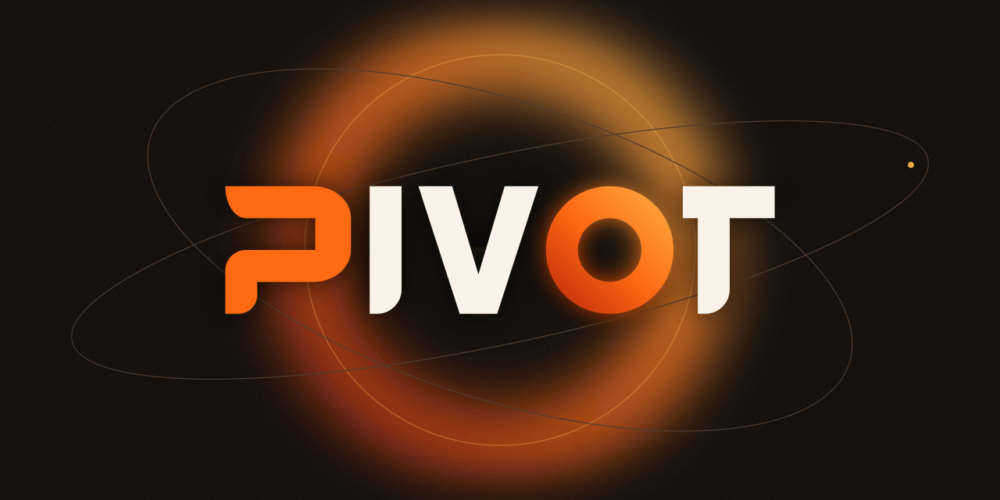

<p align="center">
  
</p>

# PIVOT

Personal UI/UX resource library that runs on your machine: save websites (with automatic screenshots), images, icons, animations, palettes, prompts, Claude Code skills, snippets, rules, checklists and MCP configs — then copy or export them as context for Claude Code, or let Claude Code design from them directly (see [Design with Claude Code](#design-with-claude-code)).

Requirements: [docs/SPEC.md](docs/SPEC.md) (decisions) · [docs/requirements-v0.1.md](docs/requirements-v0.1.md) (original brief) · Design: [DESIGN.md](DESIGN.md).

## Run

```bash
npm start
```

Installs dependencies and Playwright's Chromium if missing, rebuilds when the code changed, serves on <http://127.0.0.1:4321> and opens the browser. `npm run dev` runs the Next.js dev server with the same settings.

## Configuration (`.env` at the repo root)

| Variable                                                                 | Default            |                                                                                                                                                       |
| ------------------------------------------------------------------------ | ------------------ | ----------------------------------------------------------------------------------------------------------------------------------------------------- |
| `DATABASE_URL`                                                           | _unset_            | Unset → embedded Postgres (PGlite) in `~/.pivot/db`, works offline. Set → Neon/any Postgres.                                                          |
| `PIVOT_DATA_DIR`                                                         | `~/.pivot`         | Database (local mode), files (when R2 is not set), cache, default export folder.                                                                      |
| `R2_ACCOUNT_ID`, `R2_ACCESS_KEY_ID`, `R2_SECRET_ACCESS_KEY`, `R2_BUCKET` | _unset_            | All four set → screenshots and uploads go to a private Cloudflare R2 bucket instead of this computer. `R2_ENDPOINT` only for EU-jurisdiction buckets. |
| `CLAUDE_SKILLS_DIR`                                                      | `~/.claude/skills` | Global skills that the Skills view syncs with.                                                                                                        |
| `PORT`                                                                   | `4321`             |                                                                                                                                                       |

Files (screenshots, uploads) go to Cloudflare R2 when the R2 keys are set, otherwise to the data folder. The app serves them itself, so the bucket stays private. Each file remembers where it lives, so switching is safe; Settings › Files has **Test storage** and **Move local files to R2**. Files that Copy context hands to Claude Code are downloaded to `~/.pivot/cache` and pruned after a week.

## Everyday use

- **⌘K** — search everything, jump anywhere, create; **⌘↵** on a result copies it.
- **⌘V anywhere** — paste one or many URLs to add them; paste an image to save it. Drag files onto the window to upload.
- **Select** cards (hover checkbox, ⇧-click for ranges, ⌘A) → _Copy context_ or _Export_ a bundle (`context.md`, prompts, skills, resized assets) into any folder, with a token estimate.
- **Prompts** support `{{variable}}` and `{{variable|default}}`; copying asks for the values.
- **Skills** sync from `~/.claude/skills` automatically when you open the Skills view. Edits stay in the app until you press _Save to disk_; changes on both sides are flagged as a conflict.
- **Trash** keeps deleted items for 30 days.

## Chrome extension

```bash
pnpm ext:build
```

Then in Chrome: `chrome://extensions` → enable **Developer mode** → **Load unpacked** → pick `apps/extension/dist`. Open the extension's options and paste the server URL and API token from PIVOT › Settings › Browser extension.

- **⌥⇧S** / toolbar button — popup with a screenshot of what you see (works on logged-in pages), title and description read from the page, type, facets, notes, collection. If text is selected, you can save it as a snippet, prompt, rule or checklist instead.
- **⌥⇧D** — quick-save the current tab without the popup.
- **Right-click** a page, link or image → _Save … to PIVOT_; selected text → _Save selection as snippet / prompt_.

The token is what lets the extension write to the API; regenerate it in Settings if it leaks. After changing extension code, run `pnpm ext:build` (or `pnpm ext:dev` to rebuild on save) and press reload on the extension card.

## Design with Claude Code

Two pieces let Claude Code design and redesign screens in any project from **your** saved references:

- **The `pivot` MCP server** (`apps/mcp`): the tools Claude uses to search and look at your library, and to keep a design session's brief and decisions in PIVOT.
- **Two skills** (`.claude/skills`): the workflow Claude follows with those tools.
  - `pivot-design`: for new screens and components.
  - `pivot-redesign`: for UI that already exists.

### Set up (once)

1. **Start PIVOT:** run `npm start`. The tools work through the running app at `http://127.0.0.1:4321`.
2. **Build and register the MCP server for every project:**
   ```bash
   pnpm mcp:build
   claude mcp add pivot --scope user -- node /absolute/path/to/stan-bag/apps/mcp/dist/server.js
   ```
   In Claude Code, `/mcp` should list `pivot` as connected. Write tools use the API token from `~/.pivot/api-token`, which is created automatically. Details and troubleshooting: [apps/mcp/README.md](apps/mcp/README.md).
3. **Install the skills:**
   ```bash
   pnpm skill:install
   ```
   This **symlinks** `~/.claude/skills/pivot-design` and `pivot-redesign` to `.claude/skills/` in this repo, and `~/.claude/agents/pivot-specialist.md` (the read-only agent that runs specialist skills for them) to `.claude/agents/`. It never replaces a file that's already there. There is one copy, kept in git: edit the skills here and every project picks up the change. Claude Code reads whatever branch this checkout is on, so keep it on `dev` for day-to-day use. Agents are loaded when a Claude Code session starts, so open a new session after the first install.

### Tools (the `pivot` MCP server)

| Tool                     | Kind  | What Claude uses it for                                                                             |
| ------------------------ | ----- | --------------------------------------------------------------------------------------------------- |
| `list_facets`            | read  | Learn the library's vocabulary once per task: page types, domains, styles, patterns, collections    |
| `search_references`      | read  | Find references by words and facets, inside a collection or from a source                           |
| `get_reference`          | read  | One reference's link, description, your notes, facets and available screenshots                     |
| `get_reference_images`   | read  | Look at it: the cover, and the full page in ~2,000-token slices                                     |
| `search_external`        | read  | Free public component catalogs (Magic UI, React Bits, shadcn/ui), only when the library falls short |
| `save_design_brief`      | write | Store the brief at a milestone: `initial` (opens a design session), `approved`, `major_change`      |
| `record_design_decision` | write | Record your `approval`, a `change` after approval, or a QA `deviation`                              |
| `save_design_mockups`    | write | Put a round of mockups on the session's page in PIVOT, where you compare them and approve one       |
| `set_design_status`      | write | Mark an approved session `building` when Claude starts coding, and `done` after the build and QA    |
| `get_design_session`     | read  | Read a session to continue earlier work, or the approval you made in PIVOT                          |
| `suggest_metadata`       | write | Suggest facets or a title for a reference; it waits in your Inbox                                   |
| `annotate_reference`     | write | Add a dated agent note to a reference; your notes stay as they are                                  |
| `save_reference`         | write | Save a page to the library, only when you ask                                                       |

**Where things live:**

- Briefs, mockups and decisions live in PIVOT (the **Design sessions** button, `/design`), never in the project being designed.
- Nothing Claude writes overwrites what you confirmed.

### Which skill

| You want to…                   | Skill                | Example request                                                       |
| ------------------------------ | -------------------- | --------------------------------------------------------------------- |
| Design something new           | `pivot-design`       | "Design the onboarding screen for this app using my PIVOT references" |
| Rework something that exists   | `pivot-redesign`     | "The pricing cards feel flat and hard to compare. Rework the layout"  |
| Make one explicit small change | either (no workflow) | "The Sign in button sits 2px low. Align it"                           |

Claude usually picks the right skill. Start with "Use pivot-design…" or "Use pivot-redesign…" to be sure.

### The flow

1. **Classify.** `pivot-redesign` states:
   - a **path**: A, reference-led (you named references, a page to match, or asked for inspiration), or B, direct;
   - a **risk level**, which decides the approval step:

   | Risk      | Covers                                                                               | Approval                                                                    |
   | --------- | ------------------------------------------------------------------------------------ | --------------------------------------------------------------------------- |
   | Small fix | One change you already specified                                                     | None. No session; it fixes and checks that spot                             |
   | Minor     | Styling inside existing tokens; layout unchanged                                     | Proposes a direction and waits for a yes, unless you authorised it up front |
   | Major     | Layout, hierarchy, structure, responsive behaviour, shared components or other pages | **Always a mockup and an explicit yes.** "Just do it" is not approval       |

   New designs with `pivot-design` follow the Major path.

   Both also state a **motion level**: `none` (the default), `standard` (micro-interactions, transitions) or `advanced` (scroll storytelling, pinning, morphing…). Your words decide it when you say anything about motion. Changing how something moves is always Major. The rules live in `.claude/skills/pivot-design/motion.md`.

2. **Specialist checkpoint.** One line: `Specialists: none — <reason>`, or `<name> — <stage> — <purpose>`.
   - The installed specialists are `ui-ux-pro-max`, `design-taste-frontend` (public pages only) and `impeccable` (QA audit).
   - "None" is a valid answer. Ask for one by name if you want it.
3. **Impact and baseline** (redesign):
   - the files, shared components and pages the change touches;
   - a keep list;
   - "before" screenshots.
4. **References** (new designs and path A):
   - references you named come first;
   - then `list_facets` once and 2–3 library searches;
   - about 12 images at most;
   - a **shortlist** of 6–10 candidates, each linked to its PIVOT page. Claude stops so you can pick, for example "2, 5, 7: the table of 5". Say "you choose" to skip the pause.
5. **Brief, then save.** A short brief with a Take / Leave table per reference (and a **Motion** block when the level isn't none, each item marked essential or detail), shown to you, then saved as `initial` (this opens the design session). The brief always comes before the mockups.
6. **Mockups.** 2–3 genuinely different directions by default, 4–5 when broad exploration helps (or the number you ask for), as static HTML, never in your project. For a redesign, before and after are side by side. A component is shown in the page it lives in, with its states (hover, focus, disabled, loading, error, long content), and the brief adds its props and variants; a small one often gets 2–3 versions that really differ instead of five.
   - Claude saves them to the design session (`save_design_mockups`) and gives you its link. The **Mockups** section shows them as tabs at desktop, tablet or phone width; keys 1–9 switch versions. Each new round is kept, older ones a click away.
   - **Motion:** standard motion is shown with CSS in the PIVOT mockups. Advanced motion also gets an executable preview of the top 1–2 directions in the local viewer. You preview reduced motion with your OS or DevTools setting; nothing fakes it.
   - The local **viewer** (`index.html` in the scratch folder) runs every version sandboxed: no network, no other files, no navigation or popups. Scripts run only in versions marked interactive. It is also the fallback when PIVOT can't store the mockups. Its **Choose this version** copies a reply for the chat.
7. **Approval.** Claude stops and waits, in either place:
   - **In PIVOT:** press **Approve this version**, optionally with a note ("keep the table of version 2"). Claude is waiting on it in the background and starts building straight away; you don't go back to the chat. A note that asks for a different structure makes Claude ask first.
   - **In the chat:** your reply is recorded **word for word**, and instructions from anyone else are labelled separately.
   - "Pick A, keep the group labels" approves.
   - A mix or a change gets a revised proposal.
   - A "no" means nothing is built.
   - Motion is approved here too, not in a separate step. For advanced motion, every essential item must have been previewed and runnable, unless you explicitly accept an exception in the same message.
8. **Build.** Claude marks the session **Building**, then builds only the approved direction, with your project's tokens and components. A new token, variant or shared-component change is proposed separately and needs its own approval.
9. **QA.** Checks scale with risk. A Major redesign covers:
   - 1440 and 390 px, plus 768 when there's a breakpoint there;
   - no horizontal scroll at 320 and 375;
   - states, keyboard and focus;
   - contrast and touch targets.

   Every difference from the approved design is classified:

   | Difference                                       | What happens                                           |
   | ------------------------------------------------ | ------------------------------------------------------ |
   | Refinement within the approved scope             | Listed in the summary                                  |
   | Departure from an approved requirement or detail | Reported and recorded as a `deviation`                 |
   | Material change of direction, scope or behaviour | Claude stops and asks for re-approval (`major_change`) |
   | Pre-existing or unrelated defect                 | Reported separately as a follow-up                     |

   Every new design and every Minor or Major redesign also gets a **slop check**:
   - `impeccable detect` on the changed files when it's installed (local, no API calls);
   - a checklist against `DESIGN.md` (tokens, one primary action, spacing scale, icons, stray gradients or glows, placeholder copy, flat hierarchy);
   - for Major work, a critique against `impeccable`'s criteria.

   The report separates screenshots generated, inspected and delivered. Anything blocked or not run is marked **unverified**, never passed.

When QA is finished with nothing left for you to decide, Claude marks the session **Done**. The status stepper on the session page shows where the work is. Abandon or Reopen it there to tell Claude to stop, or to ask for a new approval.

To pick up earlier work, say "continue the Ledgerly pricing session". Claude reads it with `get_design_session`, checks its status first, and doesn't record the approval twice. The full rules are in the skills and in [docs/SPEC.md](docs/SPEC.md) §10.

## Layout

```
apps/web            Next.js app (UI + API routes)
apps/extension      Chrome extension (Manifest V3, Vite + React)
apps/mcp            stdio MCP server for Claude Code
packages/core       Database schema, migrations and all library logic
packages/mcp-tools  MCP tool definitions, independent of the transport
.claude/skills      pivot-design, pivot-redesign (+ the shared specialists.md policy)
scripts/start.mjs
```

```bash
pnpm test          # core unit + integration tests (PGlite in a temp folder)
pnpm typecheck
pnpm lint
pnpm db:generate   # after editing packages/core/src/db/schema.ts
pnpm mcp:build     # build the MCP server into apps/mcp/dist
pnpm skill:install # link the design skills and the pivot-specialist agent into ~/.claude
```

## Security

The server binds to `127.0.0.1` only. API requests must target localhost (blocks DNS rebinding) and writes must come from the app's own pages or carry the API token (blocks cross-site requests and local scripts; the extension and the MCP write tools use the token). URL fetching and screenshots refuse private/local network addresses. Uploaded files are served with a sandboxing CSP.
